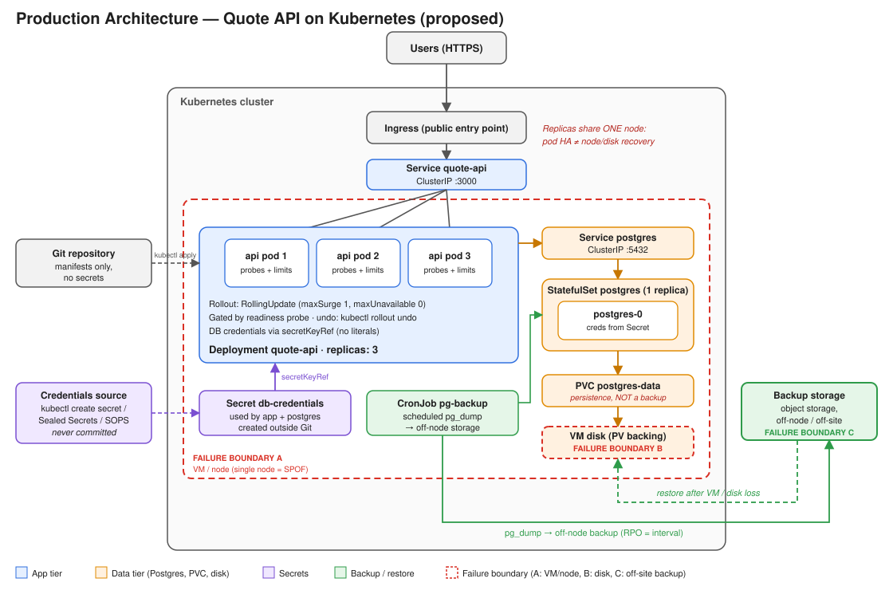
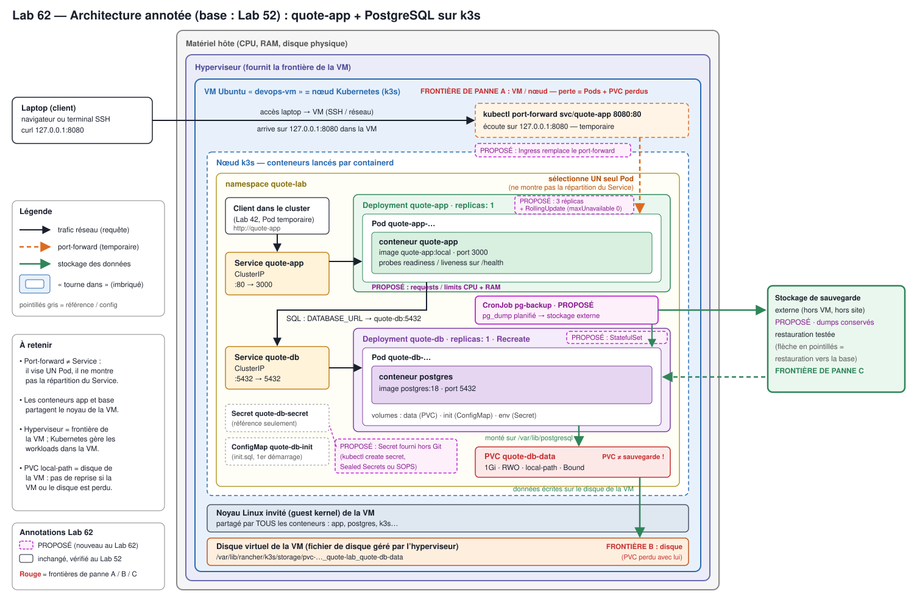

# Current System Problems

|Problème|Conséquence|Solution|
| :--- | :--- | :--- |
| Postgres dans le même conteneur que l'API | Suppression des données a chaque nouveau pod | Séparer les deux avec StatefulSet et PVC |
| pas de readiness/liveness probes | Perdition du trafic | probes sur /health |
| Pas de request/limit | Affamation du nœud par un pod gourmant | Request/limits CPU et mémoire |

# Production Architecture

### Défaillances et récupération

**Cas 1 : un Pod de l'API tombe (disponibilité)**

Le ReplicaSet du Deployment détecte qu'il manque un Pod et en recrée un. La readiness probe empêche le Service d'envoyer du trafic vers un Pod pas encore prêt. Pendant ce temps, les deux autres réplicas continuent de servir les requêtes, donc **les utilisateurs ne voient aucune interruption**. L'API est sans état, donc il n'y a aucune donnée à récupérer.

**Cas 2 : le Pod PostgreSQL tombe (disponibilité + données)**

Le StatefulSet recrée `postgres-0` et le rattache au même PVC. Les données sont conservées, mais la base est **indisponible pendant le redémarrage** (quelques secondes à quelques minutes), car il n'y a qu'une instance. L'API renvoie des erreurs pendant ce temps, mais aucune donnée n'est perdue.

**Cas 3 : la VM ou le disque est perdu (récupération des données)**

Ici, les contrôleurs Kubernetes ne peuvent plus rien faire seuls :

- Les trois réplicas de l'API et le Pod Postgres tournent sur le même nœud, donc **tout est tombé en même temps**.
- Le PVC et le volume qui le porte vivaient sur ce disque : ils disparaissent avec lui.
- Le service ne revient qu'après **reconstruction de l'infrastructure** (nouvelle VM, nouveau cluster ou nouveau nœud), redéploiement des manifestes depuis Git, recréation du Secret, puis **restauration du dernier `pg_dump`** depuis le stockage externe.
- On perd les écritures faites depuis la dernière sauvegarde (**RPO = intervalle entre deux backups**), et le temps de remise en service (**RTO**) dépend de la procédure de restauration, d'où l'importance de la tester.

### Disponibilité ≠ récupération des données

| | Disponibilité | Récupération des données |
|---|---|---|
| Question | Le service répond-il maintenant ? | Peut-on retrouver les données après un sinistre ? |
| Outils | Réplicas, probes, rolling update, ReplicaSet | Sauvegardes hors nœud, restauration testée |
| Couvre | Panne d'un Pod | Perte du disque ou de la VM, corruption, mauvaise migration |

**Un PVC n'est pas une sauvegarde.** Il assure la persistance si le Pod est recréé, mais il reste sur le même disque : si le disque est perdu, le PVC l'est aussi. Il ne protège pas non plus contre une suppression accidentelle, une corruption ou une mauvaise migration, car il contient toujours l'état actuel, y compris les erreurs. Une vraie sauvegarde est une **copie séparée, hors du nœud (idéalement hors site), dont la restauration a été testée**.

**Plusieurs réplicas sur un même nœud ne suppriment pas la dépendance à ce nœud.** Ils protègent contre la panne d'un Pod ou un déploiement raté, mais pas contre la perte de la machine qui les héberge. Pour retirer ce point de défaillance unique, il faudrait plusieurs nœuds (anti-affinité ou topology spread constraints) et, pour la base, une réplication (par exemple un opérateur PostgreSQL), ce qui ajoute de la complexité.

# Operational Strategy

**Comment le système monte en charge ?**
- L'API est sans état : on ajoute des réplicas (`kubectl scale`) ou on utilise un HPA basé sur le CPU.
- La base est le goulot d'étranglement : une seule instance en écriture. Pistes : pool de connexions, puis réplicas en lecture.
**Comment déployer les mises à jour en sécurité ?**
- `RollingUpdate` avec `maxUnavailable: 0` : un nouveau Pod ne reçoit du trafic qu'une fois prêt (readiness).
- Vérification avec `kubectl rollout status` ; retour arrière avec `kubectl rollout undo`.
- Le rollback d'un Deployment **ne restaure pas le contenu de la base ni n'annule une migration de schéma**. Pour cela : restaurer une sauvegarde ou écrire une migration inverse. Ce qui guide la décision : une mauvaise version de l'app → rollback ; des données corrompues ou perdues → restauration.
**Comment détecte-t-on les pannes ?**
- Readiness probe : retire un Pod du Service.
- Liveness probe : redémarre un conteneur bloqué.
- Événements Kubernetes (`kubectl get events`, `describe`) et, en production, monitoring avec alertes.
**Quels contrôleurs gèrent la récupération ?**
- ReplicaSet/Deployment : recréent les Pods de l'API.
- StatefulSet : recrée le Pod PostgreSQL et le rattache à son PVC.
- kubelet : redémarre les conteneurs en échec.
- **Ce qui reste hors de leur portée** : la perte de la VM ou du disque, la corruption de données. Il faut la procédure de sauvegarde/restauration et la reconstruction de l'infrastructure.

# Weakest Point

**PostgreSQL en instance unique sur un seul nœud.** C'est ce qui casserait en premier sous contrainte : si la VM ou le disque est perdu, l'API est indisponible jusqu'à la restauration, et on perd les écritures faites depuis la dernière sauvegarde.
 
**Compromis** : passer à une base hautement disponible (réplication, plusieurs nœuds, opérateur PostgreSQL comme CloudNativePG) réduirait le RPO et le RTO, mais ajoute de la complexité, des coûts et du travail d'exploitation. Pour une petite startup, des sauvegardes fréquentes et une restauration testée sont un premier palier raisonnable.
 
