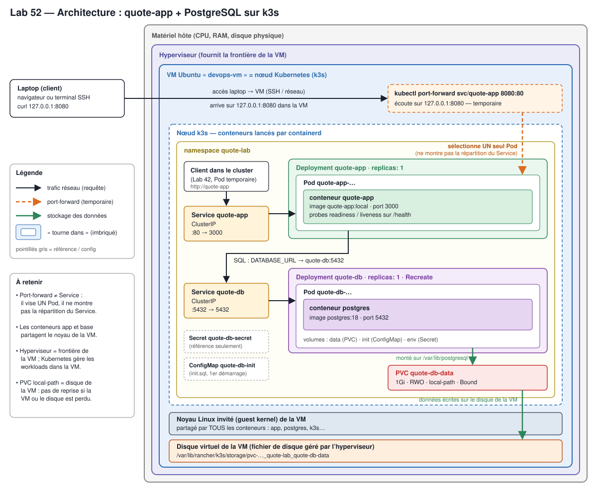

# Quel noyau est partagé ?
<Les conteneurs app et base partagent le noyau de la VM Ubuntu.>

## Ce qui survit
<Un Pod d'app est remplaçable car sans état ; la citation survit au remplacement du Pod de la base grâce au PVC ; trois réplicas + local-path sur une seule VM ne protègent pas contre la perte de la VM ou du disque. Sauvegardes et multi-nœuds : travail futur.>

tetras@devops-vm:~/res507-2025-2026-work/labs/52-architecture$ kubectl -n quote-lab get pvc
kubectl -n quote-lab get pods -l app=quote-db        # note le nom de l'ANCIEN pod
grep -F "$quote_marker" /tmp/res509-quotes.html      # marqueur AVANT

kubectl -n quote-lab delete pod -l app=quote-db
kubectl -n quote-lab get pods -l app=quote-db -w     # note le NOUVEAU nom, attends 1/1

curl --fail --show-error --max-time 10 http://127.0.0.1:8080/ -o /tmp/res509-quotes-after.html
grep -F "$quote_marker" /tmp/res509-quotes-after.html   # marqueur APRÈS
NAME            STATUS   VOLUME                                     CAPACITY   ACCESS MODES   STORAGECLASS   VOLUMEATTRIBUTESCLASS   AGE
quote-db-data   Bound    pvc-34f19e2b-6fc7-4649-8d70-9b7973ea4fa1   1Gi        RWO            local-path     <unset>                 15m
NAME                        READY   STATUS    RESTARTS   AGE
quote-db-6b6c57655c-qjwbf   1/1     Running   0          105s
    
res509-1795643658

pod "quote-db-6b6c57655c-qjwbf" deleted from quote-lab namespace
NAME                        READY   STATUS    RESTARTS   AGE
quote-db-6b6c57655c-z8l8m   0/1     Running   0          4s
quote-db-6b6c57655c-z8l8m   1/1     Running   0          8s
quote-db-6b6c57655c-z8l8m   0/1     Running   0          2m2s
quote-db-6b6c57655c-z8l8m   1/1     Running   0          2m7s
quote-db-6b6c57655c-z8l8m   1/1     Running   0          2m59s
quote-db-6b6c57655c-z8l8m   0/1     Running   0          8m28s
quote-db-6b6c57655c-z8l8m   1/1     Running   0          8m52s
quote-db-6b6c57655c-z8l8m   1/1     Running   0          9m25s
  % Total    % Received % Xferd  Average Speed  Time    Time    Time   Current
                                 Dload  Upload  Total   Spent   Left   Speed
  0      0   0      0   0      0      0      0                              100   1296 100   1296   0      0   2329      0                              100   1296 100   1296   0      0   2329      0                              100   1296 100   1296   0      0   2329      0                              0
    
res509-1795643658

## Limitation principale
La base utilise un PVC local-path sur une seule VM : la donnée survit au remplacement
du Pod, mais pas à la perte de la VM ou de son disque. Sauvegardes et multi-nœuds
restent à faire (travail futur).
